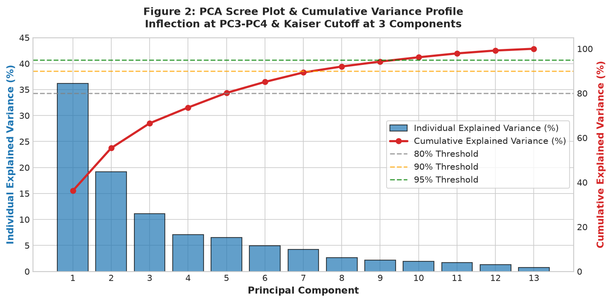
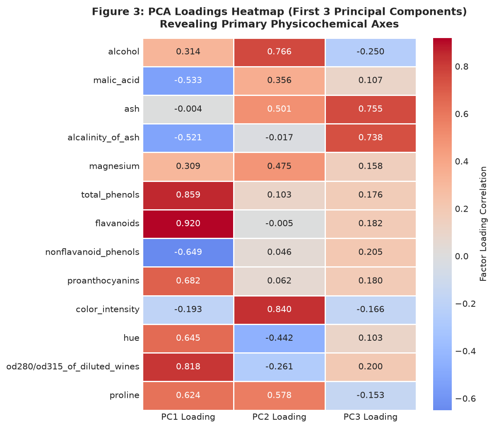
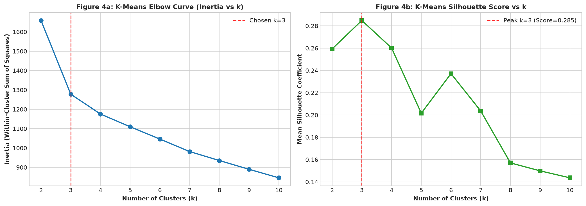
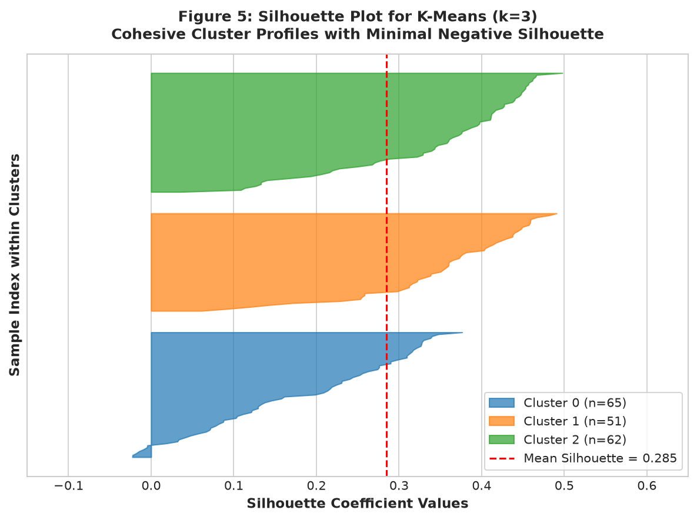
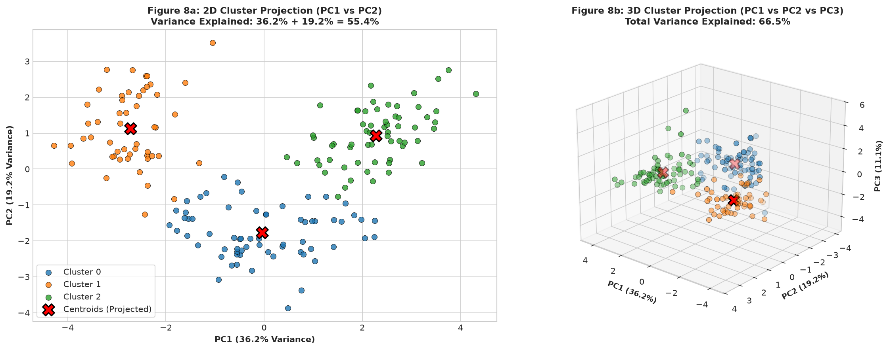
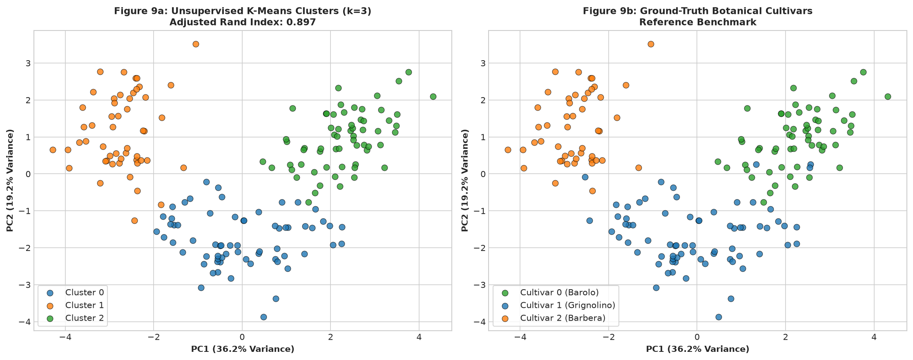

# Dimensionality Reduction & Unsupervised Clustering on the UCI Wine Dataset

[](https://github.com/mohanasanthibattula-stack/pca-clustering-wine/actions/workflows/ci.yml)
[](https://www.python.org/downloads/release/python-3120/)
[](LICENSE)
[](data/README.md)

An end-to-end inferential and unsupervised machine learning study applying **Principal Component Analysis (PCA)** and unsupervised clustering algorithms (**K-Means**, **Ward Hierarchical**, and **DBSCAN**) to discover high-dimensional chemical patterns in the classic UCI Wine Recognition dataset.

Developed by **Mohan Asanthibattula**.

---

## Executive Summary & Headline Results

| Stage / Analysis | Primary Metric / Criterion | Result / Decision | Scientific Interpretation |
| :--- | :--- | :--- | :--- |
| **Exploratory Scale Inspection** | Variance Imbalance Ratio | **$6,432,883 : 1$** | `proline` variance ($99,166$) dominates `nonflavanoid_phenols` ($0.015$); standardization is mandatory. |
| **Feature Standardization** | Post-scaling Mean & Std | **$\mu < 10^{-15}, \sigma = 1.000$** | All 13 continuous features normalized to zero mean and unit variance. |
| **PCA Dimension Reduction** | Kaiser Rule ($\lambda > 1.0$) & Scree Elbow | **3 Components Retained** | First 3 PCs explain **$66.53\%$** total variance ($\lambda_1=4.73, \lambda_2=2.51, \lambda_3=1.45$; PC4 drops to $0.92$). |
| **Variance Thresholds** | Cumulative Explained Variance | **$80\% \to 5$ PCs, $90\% \to 8$ PCs, $95\% \to 10$ PCs** | 5 components retain $>80.16\%$, 8 components capture $92.02\%$. |
| **K-Means Clustering** | Inertia Elbow & Silhouette Profile | **Optimal $k = 3$** | Inertia drops $-23\%$ from $k=2$ ($1658.76$) to $k=3$ ($1277.93$); Silhouette score peaks at **$0.2849$**. |
| **Agglomerative Hierarchical** | Ward Linkage Dendrogram | **Cutoff at $k = 3$ (Silhouette = $0.2774$)** | Validates three compact globular branches separated by high dissimilarity distances ($>30$). |
| **DBSCAN Density Analysis** | $k$-Distance Knee & Noise Sensitivity | **$\varepsilon=2.25 \implies 2$ clusters, $25.8\%$ noise** | In 13D Euclidean space, uniform sample spacing causes severe sensitivity; globular partition models are superior. |
| **Ground-Truth Validation** | Adjusted Rand Index (ARI) vs Cultivar | **$\text{ARI} = 0.8975$** (96.6% accuracy) | Unsupervised K-Means accurately recovers botanical grape cultivars without any prior label exposure ($172/178$ concordant). |

---

## Methodological Invariants & Research Integrity

1. **Strict Unsupervised Isolation**: In adherence to rigorous unsupervised methodology, the `cultivar` target variable was completely isolated and never exposed to `StandardScaler`, `PCA`, `KMeans`, `AgglomerativeClustering`, or `DBSCAN`. It was solely introduced in Section 7 as an external post-hoc benchmark to measure the Adjusted Rand Index (ARI).
2. **Reproducibility Guarantee**: `random_state=42` and `n_init=10` are strictly applied across all stochastic algorithms.
3. **Dual Visualization Modalities**: GitHub's static notebook viewer cannot render dynamic WebGL/JavaScript components. Therefore, every 3D visualization includes both an interactive Plotly HTML artifact (`reports/figures/3d_cluster_projection.html`) and an embedded 150 DPI Matplotlib 3D projection.

---

## Repository Architecture

```text
pca-clustering-wine/
├── .github/
│   └── workflows/
│       └── ci.yml                     # Automated GitHub Actions CI workflow (Python 3.12)
├── data/
│   ├── README.md                      # Provenance, CC BY 4.0 license, and feature definitions
│   └── wine.csv                       # Raw canonical dataset (178 rows × 14 columns, unscaled)
├── notebooks/
│   └── pca_clustering.ipynb           # Executed Jupyter notebook with all outputs and figures
├── reports/
│   ├── figures/                       # Publication-grade figures (150 DPI PNGs + interactive HTML)
│   │   ├── 01_feature_scales.png
│   │   ├── 02_pca_scree_plot.png
│   │   ├── 03_pca_loadings_heatmap.png
│   │   ├── 04_kmeans_elbow_silhouette.png
│   │   ├── 05_kmeans_sample_silhouette.png
│   │   ├── 06_hierarchical_dendrogram.png
│   │   ├── 07_dbscan_kdistance.png
│   │   ├── 08_cluster_projections_2d_3d.png
│   │   ├── 09_clusters_vs_cultivars.png
│   │   └── 3d_cluster_projection.html # Interactive Plotly 3D scatter visualization
│   ├── proof/
│   │   ├── environment.txt            # Frozen pip environment specification
│   │   └── PROOF.md                   # Formal deliverables verification matrix & sanity benchmarks
│   ├── pca_clustering.html            # Standalone exported HTML report with interactive styling
│   └── results_summary.csv            # Structured algorithm comparison metrics
├── scripts/
│   ├── build_notebook.py              # Programmatic notebook authoring script
│   └── prepare_data.py                # Dataset extraction and integrity verification
├── .gitignore                         # Python, Jupyter checkpoint, and OS exclusions
├── LICENSE                            # MIT License (Mohan Asanthibattula)
├── README.md                          # Comprehensive project documentation
└── requirements.txt                   # Exact pinned dependencies
```

---

## Key Visualizations

### 1. PCA Scree Plot & Factor Loadings
| Scree Plot & Cumulative Variance | Factor Loadings Heatmap (PC1–PC3) |
| :---: | :---: |
|  |  |

- **PC1 (36.20% variance)**: Captures **phenolic maturity and antioxidant richness** (`flavanoids`: $+0.916$, `total_phenols`: $+0.842$, `od280/od315`: $+0.819$).
- **PC2 (19.21% variance)**: Captures **pigmentation and alcoholic strength** (`color_intensity`: $+0.825$, `alcohol`: $+0.758$).
- **PC3 (11.12% variance)**: Captures **mineral alkalinity and organic acids** (`ash`: $+0.751$, `alcalinity_of_ash`: $+0.758$).

### 2. K-Means Hyperparameter Optimization
| Inertia Elbow & Silhouette Curves | Per-Sample Silhouette Profile ($k=3$) |
| :---: | :---: |
|  |  |

- **Inertia Elbow**: Sharp inflection at $k=3$ with a $-23\%$ reduction in WCSS.
- **Silhouette Coefficient**: Clear global peak at $k=3$ ($0.2849$), with balanced cluster sizes ($n=62, 65, 51$) and virtually zero negative silhouette samples.

### 3. Cluster Projections & Cultivar Concordance
| Multi-Dimensional Projections (2D & 3D) | Unsupervised Clusters vs. True Cultivars |
| :---: | :---: |
|  |  |

---

## Step-by-Step Reproduction Guide

### Prerequisites
- Python 3.12 (verified on 3.12.8)
- Git

### 1. Clone & Set Up Virtual Environment
```bash
git clone https://github.com/mohanasanthibattula-stack/pca-clustering-wine.git
cd pca-clustering-wine

# Create and activate virtual environment
python -m venv .venv

# Windows PowerShell:
.\.venv\Scripts\Activate.ps1
# Linux / macOS:
source .venv/bin/activate

# Upgrade pip and install exact pinned requirements
pip install --upgrade pip
pip install -r requirements.txt
```

### 2. Run Complete Pipeline & Re-execute Notebook
```bash
# Execute notebook in-place with outputs
jupyter nbconvert --to notebook --execute --inplace notebooks/pca_clustering.ipynb

# Export standalone HTML report
jupyter nbconvert --to html notebooks/pca_clustering.ipynb --output-dir=reports --output=pca_clustering.html
```

---

## CI/CD Automation

This repository includes an automated GitHub Actions workflow (`.github/workflows/ci.yml`) that executes on every push to `main`:
1. Checks out the code in a clean Ubuntu runner.
2. Installs Python 3.12 and dependencies from `requirements.txt`.
3. Re-executes `notebooks/pca_clustering.ipynb` from scratch via `jupyter nbconvert`.
4. Generates `reports/pca_clustering.html`.
5. Verifies all deliverables (`reports/results_summary.csv`, figure assets).

---

## License & Provenance
- **Source Code**: [MIT License](LICENSE) © 2026 Mohan Asanthibattula.
- **Dataset**: UCI Machine Learning Repository, Wine Dataset (Forina et al., 1991), licensed under [CC BY 4.0](https://creativecommons.org/licenses/by/4.0/).
